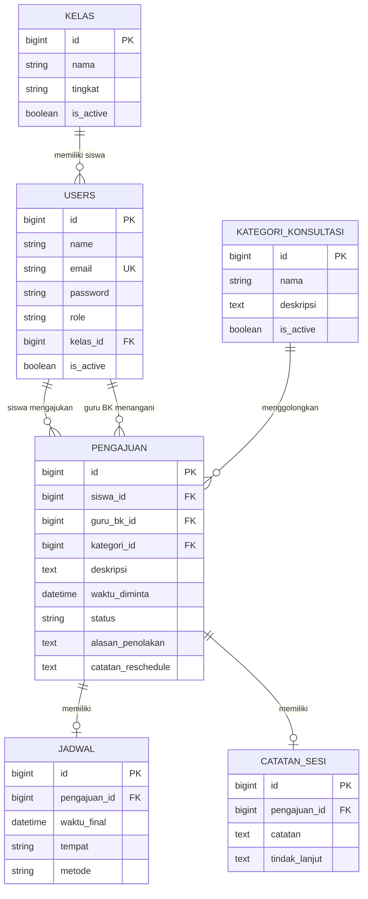

# ERD — Sistem Informasi Bimbingan dan Konseling SMAN 1 Sindangkerta

Dokumen ini hanya memakai nama sekolah SMAN 1 Sindangkerta. Nama kelas dan
nama orang di contoh adalah data umum untuk demo, bukan data resmi sekolah.

## 1. Daftar tabel dan kolom

### users
| Kolom | Tipe | Keterangan |
|-------|------|------------|
| id | bigint, PK | |
| name | string | Nama lengkap |
| email | string, unik | Dipakai untuk login |
| email_verified_at | timestamp, nullable | Bawaan Laravel |
| password | string | Disimpan ter-hash |
| role | string | `siswa` / `guru_bk` / `admin` |
| kelas_id | bigint, FK → kelas, nullable | Diisi untuk siswa |
| is_active | boolean | `false` = akun tidak dapat login |
| remember_token | string, nullable | Bawaan Laravel |
| created_at / updated_at | timestamp | |

### kelas
| Kolom | Tipe | Keterangan |
|-------|------|------------|
| id | bigint, PK | |
| nama | string | Contoh: X IPA 1 |
| tingkat | string, nullable | Contoh: X |
| is_active | boolean | |
| created_at / updated_at | timestamp | |

### kategori_konsultasi
| Kolom | Tipe | Keterangan |
|-------|------|------------|
| id | bigint, PK | |
| nama | string | Akademik, Pribadi, Sosial, Karier (data awal seeder) |
| deskripsi | text, nullable | |
| is_active | boolean | Kategori nonaktif tidak bisa dipilih siswa |
| created_at / updated_at | timestamp | |

### pengajuan
| Kolom | Tipe | Keterangan |
|-------|------|------------|
| id | bigint, PK | |
| siswa_id | bigint, FK → users | Pembuat pengajuan |
| guru_bk_id | bigint, FK → users, nullable | null = antrean; terisi = penanggung jawab |
| kategori_id | bigint, FK → kategori_konsultasi | |
| deskripsi | text | Sensitif: hanya pemilik & guru BK berwenang |
| waktu_diminta | datetime | Waktu yang diinginkan siswa |
| status | string | diajukan, ditinjau, disetujui, ditolak, dijadwalkan_ulang, selesai, dibatalkan |
| alasan_penolakan | text, nullable | Wajib saat ditolak |
| catatan_reschedule | text, nullable | Wajib saat dijadwalkan ulang |
| created_at / updated_at | timestamp | Dipakai filter periode rekap |

### jadwal
| Kolom | Tipe | Keterangan |
|-------|------|------------|
| id | bigint, PK | |
| pengajuan_id | bigint, FK → pengajuan | Satu pengajuan punya maksimal satu jadwal aktif (updateOrCreate) |
| waktu_final | datetime | Waktu final dari guru BK |
| tempat | string, nullable | Contoh: Ruang BK |
| metode | string | `tatap_muka` / `daring` |
| created_at / updated_at | timestamp | |

### catatan_sesi
| Kolom | Tipe | Keterangan |
|-------|------|------------|
| id | bigint, PK | |
| pengajuan_id | bigint, FK → pengajuan | Satu pengajuan punya maksimal satu catatan sesi |
| catatan | text | Sensitif: hanya guru BK penanggung jawab |
| tindak_lanjut | text, nullable | Bagian ini boleh ditampilkan kepada siswa pemilik |
| created_at / updated_at | timestamp | |

Tabel bawaan Laravel lainnya (`cache`, `jobs`, `sessions`, `password_reset_tokens`)
tetap dipakai untuk sesi dan antrean, tetapi bukan bagian dari domain BK.

## 2. Relasi

- `kelas` 1 — N `users` (siswa).
- `users` (siswa) 1 — N `pengajuan` lewat `siswa_id`.
- `users` (guru BK) 1 — N `pengajuan` lewat `guru_bk_id`.
- `kategori_konsultasi` 1 — N `pengajuan`.
- `pengajuan` 1 — 1 `jadwal`.
- `pengajuan` 1 — 1 `catatan_sesi`.
- Rekap admin bukan tabel: agregat `COUNT` dari `pengajuan` yang di-join ke
  `kategori_konsultasi` (per kategori) dan ke `users` + `kelas` (per kelas).

## 3. Diagram (Mermaid)

